# Architecture — `rag-tabular-analytics-worker`

> **Stateless, horizontally autoscaling Python 3.12+ Apache Arrow Flight microservice executing sandboxed DuckDB analytical queries over content-addressed Parquet artifacts.**

For operational API schemas and Prometheus/Flight contracts, see [`.ai/doc-api.md`](.ai/doc-api.md) and [`api/openapi/openapi.yaml`](api/openapi/openapi.yaml). For threat modeling and logging redaction rules, see [`.ai/security.md`](.ai/security.md).

---

## 1. System Context & Request Lifecycle

`rag-tabular-analytics-worker` serves as the isolated tabular SQL compute tier in the RAG platform. It receives validated analytical requests from `rag-search-orchestrator` over Apache Arrow Flight (HTTP/2 gRPC), hydrates content-addressed Parquet tables from S3 into a local disk-backed NVMe cache on demand, executes SQL inside disposable sandboxed DuckDB subprocesses, and streams zero-copy Arrow `RecordBatch` frames back to the caller.

```mermaid
flowchart LR
    Orch["rag-search-orchestrator (Go)"] -->|"1. Flight DoGet(Ticket) / DoAction"| Flight["TabularFlightServer (HTTP/2 gRPC :8815)"]
    Flight -->|"2. Validate ticket & sqlglot AST (<= 2 ms)"| AST["ASTValidator (internal/validator)"]
    AST -->|"3. Tenant & bucket check"| Resolver["TableResolver (internal/storage)"]
    Resolver -->|"4a. Cache Hit"| Cache["Tier-1 NVMe Cache (10 GiB, LRU)"]
    Resolver -->|"4b. Cache Miss (Single-Flight)"| S3["S3Streamer (aiobotocore Range Reads)"]
    S3 -->|"Atomic os.replace"| Cache
    Cache -->|"5. Dispatch"| Pool["ProcessManager (pebble.ProcessPool, max_tasks=100)"]
    Pool -->|"6. 5s SIGKILL Circuit Breaker"| Child["Ephemeral Child Process (duckdb :memory:)"]
    Child -->|"7. Chunked RecordBatch IPC (Pipe)"| Flight
    Flight -->|"8. Zero-Copy Arrow Stream"| Orch
    Ops["OpsHTTPServer (:8080)"] -->|"/healthz, /ready, /metrics, /openapi.yaml, /docs"| K8s["Kubernetes / Prometheus / KEDA"]
```



### End-to-End Execution Flow

1. **Flight Ingress**: `TabularFlightServer` (`internal/flight/server.py`) receives a `DoGet(Ticket)` or `DoAction(Action)` request with optional W3C `traceparent`/`tracestate` metadata.
2. **Backpressure & Concurrency Guard**: `FlightHandlers` (`internal/flight/handlers.py`) enforces `MAX_CONCURRENT_QUERIES` via a bounded semaphore, returning gRPC `RESOURCE_EXHAUSTED` when saturated.
3. **AST Whitelisting ($\le 2\text{ ms}$)**: `ASTValidator` (`internal/validator/ast_validator.py`) parses the SQL with `sqlglot`, allowing only read-only `Select`, `With` (CTEs), `Union`/`Intersect`/`Except`, and `Subquery` constructs with pre-approved functions and bounded join counts (`MAX_JOINS`).
4. **Tenant & S3 Path Validation**: `TableResolver` (`internal/storage/table_resolver.py`) checks `s3_bucket` against `S3_BUCKET_ALLOWLIST` and verifies `s3_key == f"artifacts/{tenant_id}/{table_hash}.parquet"` to prevent confused-deputy cross-tenant reads (`PERMISSION_DENIED`).
5. **Tier-1 Cache & Single-Flight S3 Hydration**: `CacheManager` (`internal/storage/cache_manager.py`) checks `<CACHE_DIR>/{s3_bucket}/{tenant_id}/{table_hash}.parquet`. On a miss, `HydrationLoopThread` (`internal/flight/daemon.py`) bridges the synchronous gRPC thread to an `asyncio` event loop running `S3Streamer` (`internal/storage/s3_streamer.py`), which streams ranged reads from S3 to a temp file and atomically commits via `os.replace`.
6. **Process-Isolated DuckDB Execution**: `ProcessManager` (`internal/pool/process_manager.py`) dispatches the query to a `pebble.ProcessPool` worker (`max_tasks=100`) under a `5s` deadline monitored by `circuit_breaker.py`.
7. **Zero-Copy Arrow IPC Streaming**: The child subprocess (`internal/pool/worker_task.py`) executes the query in a locked `:memory:` DuckDB instance (`internal/sandbox/duckdb_runtime.py`) and streams `RecordBatch` chunks over an OS pipe back to the Flight server, which yields a `pyarrow.flight.RecordBatchStream` without full-table materialization.

---

## 2. Technology Stack

| Layer | Technology | Role & Operational Characteristics |
| :--- | :--- | :--- |
| **Language Runtime** | Python 3.12+ (64-bit) | Host Arrow Flight daemon, `sqlglot` AST validation, async S3 hydration, telemetry |
| **Memory Allocator** | `jemalloc` (`LD_PRELOAD`) | Mitigates native heap fragmentation across rapid Arrow IPC allocation cycles |
| **IPC & Transport** | Apache Arrow Flight (`pyarrow.flight`) | HTTP/2 gRPC server streaming zero-copy Arrow `RecordBatch` frames (`DoGet`, `DoAction`) |
| **SQL Engine** | DuckDB (`>= 1.2.0`, `:memory:`) | Ephemeral C++ vectorized analytical engine inside isolated child processes |
| **Worker Pool** | `pebble.ProcessPool` (`max_tasks=100`) | Disposable subprocess sandboxing with isolated per-worker `5s` termination & respawn |
| **SQL Security** | `sqlglot` | Pure-Python deterministic AST whitelisting ($\le 2\text{ ms}$) before subprocess dispatch |
| **Tier-1 Cache** | Disk-backed `10 GiB` NVMe `emptyDir` | Content-addressed `{hash}.parquet` cache with single-flight coalescing, in-memory LRU, & `os.replace` |
| **Object Storage** | AWS S3 (`aiobotocore`) | Range-read streaming over internal VPC endpoints on cache miss (no monolithic heap buffering) |
| **Ops & Doc API** | `ThreadingHTTPServer` + OpenAPI 3.1 | `/healthz`, `/ready`, `/metrics`, `/openapi.yaml`, `/docs` |
| **Autoscaling** | Kubernetes + KEDA `ScaledObject` | Scales `4..24` replicas on `tabular_worker_active_queries` |

---

## 3. Production-Grade 5-Layer Backend Architecture

### Layer 1: API & Routing
- **Daemon Entrypoint (`cmd/worker/main.py` -> `internal/flight/daemon.py`)**: `WorkerDaemon` wires 12-factor `Settings` (`internal/config/settings.py`), `MetricsRegistry`, `ASTValidator`, `TableResolver`, `CacheManager`, `S3Streamer`, `ProcessManager`, `FlightHandlers`, `TabularFlightServer`, and `OpsHTTPServer`, and handles `SIGINT`/`SIGTERM` for graceful draining.
- **Arrow Flight RPCs (`api/flight/`, `internal/flight/`)**:
  - `DoGet(Ticket)`: JSON-encoded `FlightQueryTicket` (`request_id`, `tenant_id`, `sql`, `table_alias`, `table_hash`, `s3_bucket`, `s3_key`).
  - `DoAction(Action)`: `cache_warm` (pre-fetches `{hash}.parquet` into Tier-1 cache) and `health_check` (reports active worker status).
- **HTTP Operational & OpenAPI 3.1 Endpoints (`internal/flight/ops_server.py`)**: `GET /healthz`, `GET /ready` (verifies `ProcessManager.is_healthy()`, `CacheManager.is_writable()`, and drain state), `GET /metrics`, `GET /openapi.yaml`, and `GET /docs` (Swagger UI).
- **Sync/Async Event Loop Bridge**: `pyarrow.flight.FlightServerBase` runs synchronous C++ gRPC threads; `HydrationLoopThread` runs a dedicated background `asyncio` event loop bridged via `asyncio.run_coroutine_threadsafe` for `aiobotocore` S3 hydration.

### Layer 2: Data Persistence & State
- **Stateless Compute Tier**: Owns no relational database state; schema cataloging and document metadata live upstream in `rag-kb-catalog-service`.
- **Tier-1 Local Artifact Cache (`internal/storage/cache_manager.py`)**:
  - Stores artifacts at `<CACHE_DIR>/{s3_bucket}/{tenant_id}/{table_hash}.parquet` on a disk-backed `10 GiB` NVMe `emptyDir` (`medium: ""`).
  - Uses per-key single-flight coalescing, atomic temp-file-then-rename (`os.replace`) writes, lock-free concurrent readers, and an in-memory LRU index (independent of `noatime` mounts).
  - Never mounts a `10 GiB` `tmpfs` (`medium: Memory`) inside a `6.0 GiB` pod, preventing Linux cgroup `OOMKill`.
- **S3 Range-Read Streaming (`internal/storage/s3_streamer.py`)**: Streams chunks (`S3_CHUNK_SIZE_BYTES`, default `8 MiB`) directly to disk without buffering entire Parquet objects on the Python heap.
- **Chunked Pipe IPC**: Child workers stream Arrow `RecordBatch` frames over OS pipes / `multiprocessing.connection` (`ARROW_BATCH_SIZE`, default `8192` rows) rather than `fetch_arrow_table()` or `/dev/shm`.

### Layer 3: Architecture & Scale
- **Process-Isolated Disposable Sandboxing (`internal/pool/`)**:
  - `ProcessManager` maintains a `pebble.ProcessPool` (`max_workers=POOL_SIZE`, `max_tasks=MAX_TASKS_PER_CHILD` = `100`) so native C++ faults, memory spikes, or `SIGKILL` cancellations never crash the Flight daemon or poison sibling workers (`ADR-001`).
  - `circuit_breaker.py` enforces `QUERY_TIMEOUT_SECONDS` (`5.0s`), terminating only the offending child (`SIGKILL` on POSIX / `TerminateProcess` on Windows) and respawning a fresh worker.
- **Memory Partitioning Blueprint (`ADR-003`)**:
  - **Pod Cgroup Limit**: `6.0 GiB` (`4.0 GiB` request); CPU `2,000m` request / `4,000m` limit.
  - **DuckDB Aggregate Ceiling**: `2.5 GiB` (`DUCKDB_TOTAL_MEMORY_BYTES = 2,684,354,560`) divided across `POOL_SIZE` workers (`floor(2.5 GiB / 4) = 640MiB` per child).
  - **Host Daemon & Arrow Headroom**: `>= 2.0 GiB` for Python Flight daemon, PyArrow IPC buffers, `sqlglot` ASTs, and gRPC frames.
  - **OS Page Cache & Margin**: `1.5 GiB` headroom below the `6.0 GiB` cgroup ceiling to eliminate Linux `OOMKill` (exit `137`).
- **KEDA Autoscaling (`deployments/helm/templates/scaledobject.yaml`, `ADR-004`)**: Scales `4..24` replicas based on `tabular_worker_active_queries` (`pollingInterval: 10s`, `cooldownPeriod: 60s`).

### Layer 4: Security & Identity
- **Tenant & S3 Isolation**: `TableResolver` enforces `S3_BUCKET_ALLOWLIST` and canonical `s3_key == f"artifacts/{tenant_id}/{table_hash}.parquet"`. Cache entries are strictly scoped by `{s3_bucket}/{tenant_id}/{table_hash}`.
- **Deterministic SQL AST Whitelisting (`internal/validator/`, `ADR-005`)**:
  - Permits only `Select`, `With`, `Union`/`Intersect`/`Except`, and `Subquery` nodes with pre-approved functions (`rules.py`).
  - Blocks DML/DDL, `PRAGMA`, `SET`, `RESET`, `COPY`, `ATTACH`, `DETACH`, `LOAD`, `INSTALL`, `SUMMARIZE`, `DESCRIBE`, `SHOW`, `PIVOT`, and DuckDB filesystem/network functions (`read_csv`, `read_parquet`, `scan_parquet`, `write_csv`).
- **DuckDB Sandbox Locks (`internal/sandbox/security_profile.py`, `duckdb_runtime.py`)**:
  - Opens `duckdb.connect(":memory:")`, configures `allowed_paths = ['<validated_parquet_path>']`, binds a single temp table/view for the validated `{hash}.parquet` file, and immediately locks:
    - `SET enable_external_access = false`
    - `SET lock_configuration = true`
    - `SET temp_directory = ''`
    - `SET threads = 2`
    - `SET memory_limit = '<worker_memory_limit_mib>MiB'`
- **Secured Logging & Container Hardening**:
  - `internal/telemetry/logging.py` emits structured JSON logs and redacts `Authorization`/`Bearer` headers, AWS credentials, presigned S3 query params (`X-Amz-Signature`, `X-Amz-Credential`, `X-Amz-Security-Token`), and sensitive PII/literals.
  - Multi-stage non-root container (`uid=10001`, `readOnlyRootFilesystem: true`, `capabilities.drop: ["ALL"]`) with `jemalloc` preloaded.

### Layer 5: Observability & Quality
- **Structured JSON Logging (`internal/telemetry/logging.py`)**: Correlates `trace_id`, `request_id`, `tenant_id`, `table_hash`, `cache_state`, `duration_ms`, and `status`.
- **Prometheus Metrics (`internal/telemetry/metrics.py`)**:
  - `tabular_worker_active_queries` (Gauge — KEDA trigger)
  - `tabular_worker_query_duration_seconds` (Histogram, label: `cache_state`)
  - `tabular_worker_cache_hit_ratio` (Gauge)
  - `tabular_worker_cache_hits_total` / `tabular_worker_cache_misses_total` (Counters)
  - `tabular_worker_cache_bytes_used` (Gauge)
  - `tabular_worker_subprocess_recycles_total` (Counter, label: `reason`: `TIMEOUT`, `MEMORY_LIMIT`, `TASK_LIMIT`, `CRASH`)
  - `tabular_worker_flight_stream_bytes_total` (Counter)
  - `tabular_worker_ast_rejections_total` (Counter, label: `rule`)
- **Distributed Tracing (`internal/telemetry/tracing.py`)**: OpenTelemetry spans across Flight ingress (`FlightTracingMiddlewareFactory`), AST validation, S3 hydration, and subprocess execution.

---

## 4. Architecture Decision Records (ADRs)

| ID | Decision | Rationale |
| :--- | :--- | :--- |
| **ADR-001** | **Subprocess Worker Isolation (`pebble.ProcessPool`, `max_tasks=100`)** | Allows isolated per-worker `5s` `SIGKILL` without `BrokenProcessPool` and isolates native DuckDB C++ faults from the Flight daemon. |
| **ADR-002** | **Dedicated Disk-Backed `10 GiB` NVMe Cache** | Eliminates per-query S3 round-trips (meeting warm-cache `P95 <= 45 ms`) while avoiding `10 GiB` `tmpfs` RAM exhaustion in a `6.0 GiB` pod. |
| **ADR-003** | **Defensive Memory Budgeting (`6.0 GiB` Pod / `2.5 GiB` DuckDB)** | Reserves `>= 2.0 GiB` for Python/Arrow IPC and `1.5 GiB` OS page cache margin to prevent Linux `OOMKill` (exit `137`). |
| **ADR-004** | **In-Flight Concurrency Autoscaling (KEDA)** | Scales `4..24` replicas on `tabular_worker_active_queries` rather than raw HTTP/2 connection counts. |
| **ADR-005** | **Query-Level AST Whitelisting via `sqlglot`** | Deterministically rejects non-read-only SQL and DuckDB filesystem/admin exploits within `<= 2 ms` before engine execution. |

---

## 5. Repository Structure

```text
rag-tabular-analytics-worker/
├── cmd/
│   └── worker/
│       └── main.py                      # CLI entrypoint invoking WorkerDaemon
├── api/
│   ├── flight/
│   │   ├── actions.py                   # DoAction request/response models (cache_warm, health_check)
│   │   └── schema.py                    # FlightQueryTicket & gRPC error mapping definitions
│   └── openapi/
│       └── openapi.yaml                 # OpenAPI 3.1 specification for HTTP ops endpoints
├── internal/
│   ├── config/
│   │   └── settings.py                  # 12-factor Pydantic Settings (TABULAR_WORKER_*)
│   ├── flight/
│   │   ├── daemon.py                    # WorkerDaemon & HydrationLoopThread orchestrator
│   │   ├── handlers.py                  # Ticket resolution, AST check, cache/S3, pool dispatch
│   │   ├── ops_server.py                # HTTP ops server (/healthz, /ready, /metrics, /openapi.yaml, /docs)
│   │   └── server.py                    # Apache Arrow FlightServerBase implementation
│   ├── pool/
│   │   ├── circuit_breaker.py           # 5s execution deadline & isolated child termination
│   │   ├── process_manager.py           # pebble.ProcessPool supervisor (max_tasks=100)
│   │   └── worker_task.py               # Child subprocess entrypoint streaming Arrow IPC batches
│   ├── sandbox/
│   │   ├── duckdb_runtime.py            # Ephemeral duckdb.connect(":memory:") execution
│   │   └── security_profile.py          # allowed_paths, enable_external_access=false, memory/thread locks
│   ├── storage/
│   │   ├── cache_manager.py             # Disk-backed NVMe LRU cache with single-flight & os.replace
│   │   ├── s3_streamer.py               # Async aiobotocore S3 range-read streamer
│   │   └── table_resolver.py            # Tenant/bucket allowlist & canonical s3_key validation
│   ├── telemetry/
│   │   ├── logging.py                   # Structured JSON logger with secret/PII redaction
│   │   ├── metrics.py                   # Prometheus MetricsRegistry
│   │   └── tracing.py                   # OpenTelemetry tracer & Flight tracing middleware
│   └── validator/
│       ├── ast_validator.py             # sqlglot AST whitelist validator (<= 2 ms)
│       ├── exceptions.py                # ValidationError hierarchy
│       └── rules.py                     # Allowed AST nodes, functions, & banned constructs
├── deployments/
│   ├── docker/Dockerfile                # Multi-stage non-root image with jemalloc preloaded
│   ├── helm/                            # Helm chart, values-{staging,prod}.yaml, KEDA ScaledObject
│   ├── argocd/                          # ArgoCD staging/prod apps & canary Rollout
│   └── SECRET_MANAGEMENT.md             # Secret injection & IAM guidelines
├── scripts/
│   └── sync_env_to_deployments.py       # Syncs .env.prod -> deployments/helm/values.yaml
├── test/
│   ├── unit/                            # AST, cache, settings, sandbox, metrics, tracing, Helm tests
│   ├── integration/                     # End-to-end Arrow Flight IPC & mock S3 tests
│   ├── security/                        # SQL injection & sandbox escape fuzz tests
│   ├── chaos/                           # Subprocess SIGKILL, 500-stream soak, & OOM endurance tests
│   └── fixtures/                        # Normalized Parquet test datasets & sample queries
├── .github/workflows/
│   ├── ci.yml                           # Lint, mypy, bandit, pip-audit, OpenAPI sync, tests, Helm lint
│   └── deploy.yml                       # Container build & deployment workflow
├── Makefile                             # format, lint, typecheck, security, test, check targets
├── pyproject.toml                       # Dependencies, ruff, mypy, and pytest configuration
├── architecture.md                      # This architectural reference
└── README.md                            # Quick start, configuration, & operations guide
```
